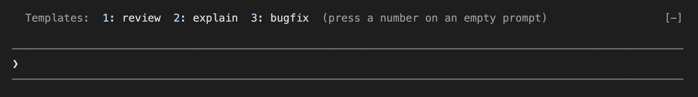
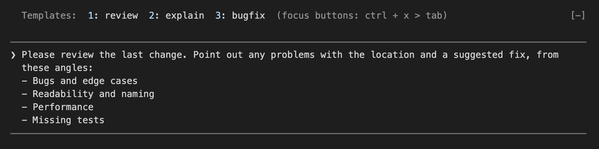

# claude-code-mod-prompt-templates

English | [日本語](README.ja.md)

A Claude Code mod (function hooks plugin) that puts a row of buttons right above the prompt input, so you can insert a prompt template with a number key. Templates are only inserted, never sent, so you can review and edit them before you submit.



Pressing `1` inserts the template into the prompt. The hint at the end of the row changes because the prompt is no longer empty.



Tested with Claude Code 2.1.287. The mod API is in early access and may change in future releases.

## Installation

### 1. Requirements

- Claude Code 2.1.287 or later (`claude --version`)

### 2. Get the mod

Clone (or download) this repository anywhere you like. The examples below use `~/cc-mods-prompts`.

```sh
git clone https://github.com/NaokiIshimura/claude-code-mod-prompt-templates.git ~/cc-mods-prompts
```

### 3. Load the mod

A mod is loaded from its folder. Pick one of the following.

#### Option A: for one session

Pass the folder when you start Claude Code. Nothing is changed on your machine, so this is the easiest way to try it.

```sh
claude --plugin-dir ~/cc-mods-prompts
```

#### Option B: for every session

Add the folder to `env` in `~/.claude/settings.json`, then restart Claude Code. This also works for sessions you cannot pass a flag to, such as the desktop app.

```json
{
  "env": {
    "CLAUDE_CODE_PLUGIN_DIRS": "/Users/you/cc-mods-prompts"
  }
}
```

- Use an absolute path (`~` also works)
- To load several mods, separate the folders with `:` (`;` on Windows)
- If `settings.json` already has an `env` block, add the line to it

### 4. Add templates

Put your templates in `~/.claude/prompt-templates/` (see [Templates](#templates)). To start with the samples, copy the English ones from `examples/prompt-templates/en/` (Japanese ones are in `examples/prompt-templates/ja/`).

```sh
mkdir -p ~/.claude/prompt-templates
cp ~/cc-mods-prompts/examples/prompt-templates/en/*.md ~/.claude/prompt-templates/
```

### 5. Check that it works

Start Claude Code. A row like `Templates:  1: review  2: explain  3: bugfix` appears right above the prompt, and `/tpl-reload` answers `Loaded 3 templates`.

If the row does not appear, start Claude Code with `claude --debug` and look for lines that mention `prompt-templates` in the debug log.

### Updating

Run `git pull` in the folder. A running interactive session reloads the mod when its files change; otherwise restart Claude Code.

### Uninstalling

Stop passing `--plugin-dir`, or remove the folder from `CLAUDE_CODE_PLUGIN_DIRS`. Then delete the folder, and `~/.claude/prompt-templates/` if you no longer need your templates.

## Usage

### Pressing a button

| When | How | Hint at the end of the row |
| --- | --- | --- |
| The prompt is empty | Press the number key | `(press a number on an empty prompt)` |
| The prompt has a draft | Press ctrl+x, then tab to focus the buttons, then the number key (Esc returns to the prompt) | `(focus buttons: ctrl + x > tab)` |
| Fullscreen terminal / desktop app | You can also click a button | (no hint) |

- In a terminal on the main screen (for example, inside tmux), clicks do not reach Claude Code, so use the keys
- The first 9 templates get `1`–`9`. With 10 or more, press `0: More…` to open the full list and pick one
- Hide or show the row with `/tpl-bar`
- You can insert a template while the model is responding
- The blank line between the row and the prompt is Claude Code's own spacing above the prompt; a mod cannot remove it

### Commands

These work where the buttons are not shown (the VS Code extension, mobile) and while the row is hidden.

| Command | What it does |
| --- | --- |
| `/tpl <name>` | Inserts a template (matches the key first, then the label; case-insensitive) |
| `/tpl` | Opens the template list |
| `/tpl-bar` | Shows or hides the button row |
| `/tpl-reload` | Reloads the templates (after you add or change files) |

## Templates

### Locations

| Location | Use |
| --- | --- |
| `~/.claude/prompt-templates/*.md` | Templates for every project |
| `<project>/.claude/prompt-templates/*.md` | Templates for that project only. These win over user templates with the same file name |

### Format

One Markdown file per template. The file name without `.md` is the key. The frontmatter is optional.

```markdown
---
label: review
mode: replace
order: 1
---
Please review the last change.
```

| Field | Meaning | Default |
| --- | --- | --- |
| `label` | The name shown on the button | The file name |
| `mode` | `insert` (at the cursor) / `replace` (replace the draft) / `append` (add to the end) | `insert` |
| `order` | Sort order (ascending numbers) | After the templates that have `order`, sorted by name |

Trailing newlines in the body are removed before insertion.

## Development

```sh
claude plugin validate .   # check the manifest and hooks
claude plugin test .       # run hooks/*.test.ts(x)
```

| File | Contents |
| --- | --- |
| `hooks/register.tsx` | Hooks, drawing and commands. They live in one file because `$` and state cannot be passed to functions imported from other files |
| `hooks/parse.ts` | Pure functions for parsing and sorting templates |
| `types/index.d.ts` | The template type and the `$.state` contract |
| `hooks/*.test.ts(x)` | Tests |
